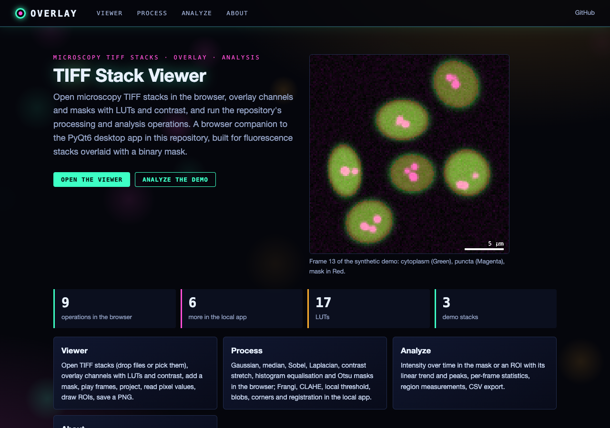
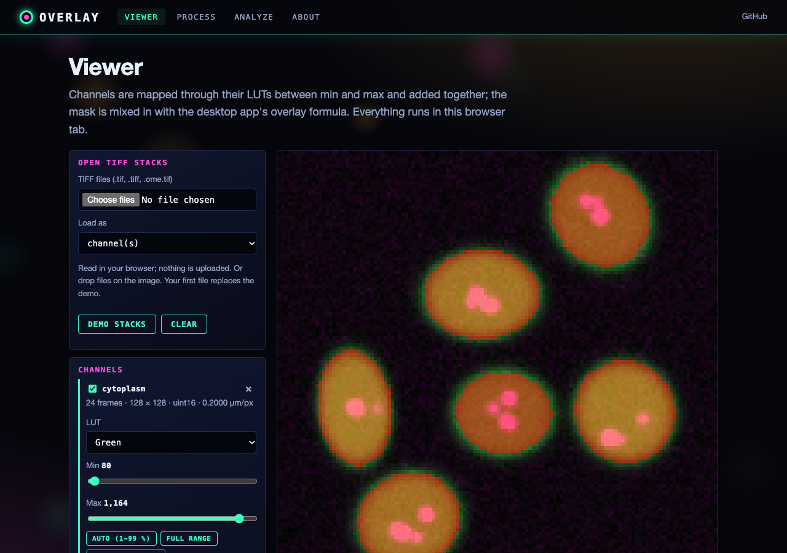
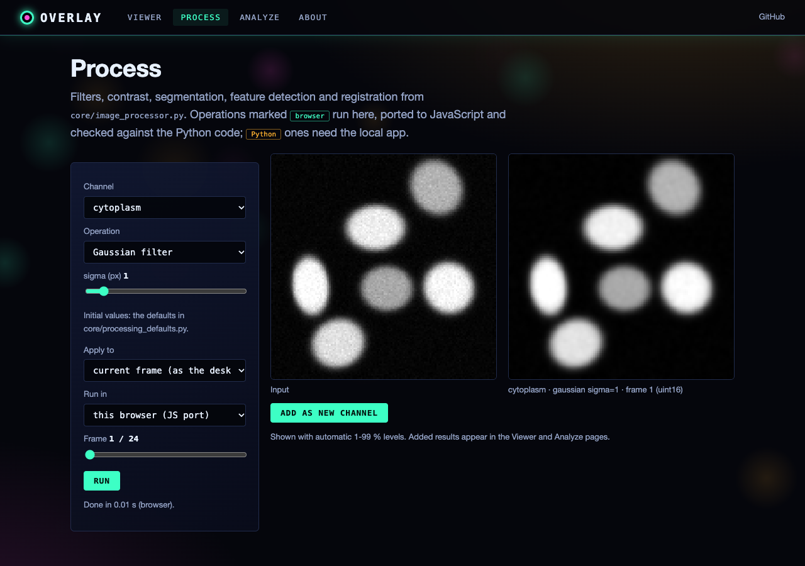
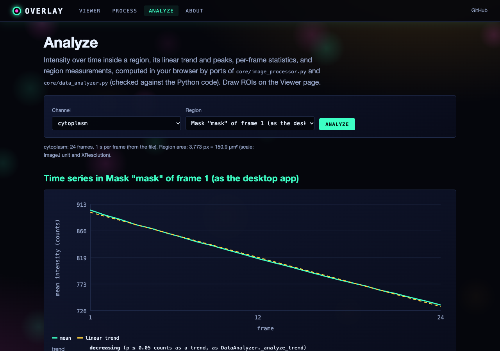

# Advanced TIFF Stack Viewer

A PyQt6-based desktop application for viewing, analyzing, and processing microscopy TIFF stacks. Designed for fluorescence microscopy workflows where a fluorescence image stack needs to be overlaid with a binary mask for region-specific analysis.

## Features

### Visualization
- **Multi-stack overlay**: Load fluorescence and mask TIFF stacks simultaneously with controllable opacity and colormap
- **Frame navigation**: Browse through time-series frames using a timeline widget, navigation bar, or keyboard shortcuts
- **Histogram display**: Real-time intensity histogram with adjustable contrast/brightness
- **Z-projection**: Maximum, minimum, and average intensity projections across the stack

### Analysis
- **ROI tools**: Draw and manage regions of interest for targeted measurements
- **Time-series analysis**: Plot intensity changes over frames within selected ROIs
- **Basic statistics**: Per-frame mean, median, standard deviation, min, max, and SNR
- **Advanced analysis**: PCA and clustering via scikit-learn integration
- **Registration**: Align misaligned image stacks
- **Measurement tools**: Distance, angle, and area measurements on images

### Processing
- **Image processing**: Filters, contrast adjustment, and basic image math
- **Export**: Save visualizations as images, movies, or tabular data files

### Command-Line Interface
- Load files directly from the command line:
  ```bash
  python main.py --fluorescence path/to/fluor.tif --mask path/to/mask.tif --debug
  ```

## Project Structure

```
overlay/
├── main.py                     # Entry point with CLI argument parsing
├── requirements.txt            # Dependencies
├── core/
│   ├── image_loader.py         # TIFF loading and ImageStack management
│   ├── image_processor.py      # Image processing algorithms
│   ├── processing_defaults.py  # Default parameters of every processing operation
│   ├── overlay_blend.py        # Mask-over-fluorescence compositing (Qt-free)
│   ├── data_analyzer.py        # Statistics, PCA, clustering analysis
│   └── export_manager.py       # Export to images, video, and data files
├── gui/
│   ├── main_window.py          # Main application window (signals, menus, layout)
│   ├── image_view.py           # Enhanced pyqtgraph-based image viewer
│   ├── controls_panel.py       # Display and overlay control panels
│   ├── dialogs.py              # Settings, contrast, projection, registration,
│   │                           #   analysis, export, and results dialogs
│   └── widgets/
│       ├── histogram_widget.py # Live intensity histogram
│       ├── roi_tools.py        # ROI drawing and management toolbar
│       ├── navigation_bar.py   # Frame navigation controls
│       └── timeline_widget.py  # Timeline scrubber widget
├── utils/
│   ├── config.py               # Application configuration (load/save)
│   ├── logger.py               # Logging setup
│   └── helpers.py              # Utility functions
├── standalone/
│   └── tiff_stack_viewer.py    # Minimal standalone viewer (fluorescence + mask)
├── web/                        # Web interface (see "Web interface" below)
└── example_data/               # Your own sample stacks (git-ignored, not in the repository)
```

## Requirements

- Python >= 3.8
- PyQt6 >= 6.2
- pyqtgraph >= 0.12
- NumPy >= 1.20
- tifffile >= 2021.8
- scikit-image >= 0.19
- SciPy >= 1.7
- pandas >= 1.3
- matplotlib >= 3.5
- h5py >= 3.6
- OpenCV (cv2)
- scikit-learn

## Installation

```bash
git clone <repository-url>
cd overlay
pip install -r requirements.txt
```

## Usage

Launch the application:

```bash
python main.py
```

Or load files directly:

```bash
python main.py -f fluorescence_stack.tif -m mask_stack.tif
```

### Quick Start

1. **File > Open Fluorescence Stack** to load your fluorescence data
2. **File > Open Mask Stack** to load a binary segmentation mask
3. Use the timeline slider or arrow keys to navigate frames
4. Adjust overlay opacity and colormap in the Display panel
5. Draw ROIs to extract region-specific intensity traces
6. Use **Analysis** dialogs for statistics, PCA, or clustering
7. Export results via the **Export** menu

## Web interface

A browser companion to the desktop app: open TIFF stacks, overlay channels and a mask with LUTs and contrast, and run
the repository's processing and analysis operations. Pages: **Viewer** (load files or the demo, per-channel LUT and
min/max with 1-99 % auto levels, mask colour and opacity, frame playback, Z-projections, pixel read-out in px and µm,
rectangle/circle ROIs, histogram, PNG export), **Process** (filters, contrast, Otsu masks, and in the local app also
Frangi, CLAHE, local threshold, blob/corner detection and registration; results become new channels or the mask),
**Analyze** (time series in the mask or an ROI with linear trend and peaks, per-frame statistics, region
measurements, CSV export) and **About**.

### Run the web app

```bash
pip install -r requirements-web.txt
python run_web.py            # http://127.0.0.1:8128 (local only)
```

### How it works

- `web/static/tiff_reader.js` is a pure-JavaScript TIFF reader (classic and BigTIFF, 8-64-bit integer/float, strips or
  tiles, uncompressed/LZW/Deflate/PackBits with predictors, chunky or planar samples; ImageJ, OME and tifffile
  layouts and pixel sizes). `tiff_reader.test.mjs` checks it against tifffile on the files written by
  `scripts/make_tiff_fixtures.py`.
- `filters.js`, `ops.js` and `stats.js` port `ImageStack`, `ImageProcessor` and `DataAnalyzer` functions;
  `ops.test.mjs` checks them against the Python code (`scripts/make_ops_fixture.py` writes the reference values).
  They run in a Web Worker. Python-only operations go to `POST /api/process` and `/api/register` (`web/compute.py`).
- Display: channels are added through their LUTs; the mask uses the desktop formula from `core/overlay_blend.py`.
- Demo data (`web/static/demo/`) are synthetic, drawn by `scripts/make_demo_data.py`; the mask is made by
  `ImageProcessor` (Gaussian, then Otsu). The 0.2 µm pixel size in them is made up.

### Static site (GitHub Pages)

`python scripts/build_static.py --out site` exports the front end and the catalogue JSON; `.github/workflows/pages.yml`
publishes it on every push to main (Settings → Pages → Source: GitHub Actions). On the static site everything except
the Python-only operations works, in the browser.

Tests: `python -m pytest -q tests` (web API, static build, Python/JS agreement through node, fixtures current,
regression tests); smoke test and screenshots: `python scripts/screenshots.py --static "" viewer process analyze about`.






## Debugging

- Logs are saved to `~/.tiff_stack_viewer/logs/`
- Pass `--debug` on the command line for verbose logging
- Use **View > Show Log** within the application

## GUI Framework

Built with **PyQt6** and **pyqtgraph** for high-performance image rendering.

## License

MIT License -- see the LICENSE file for details.
